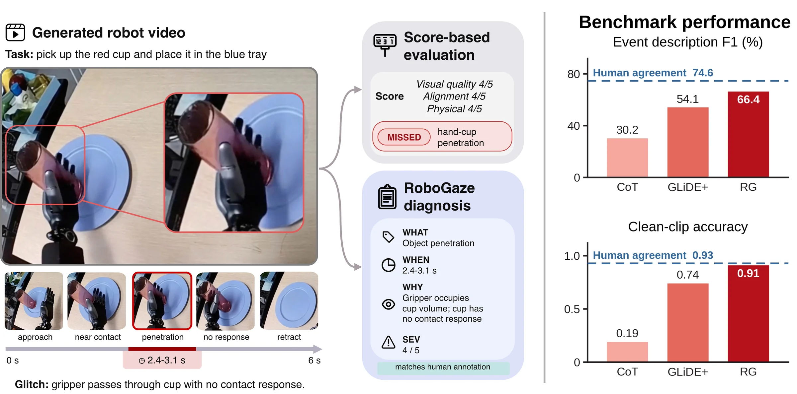
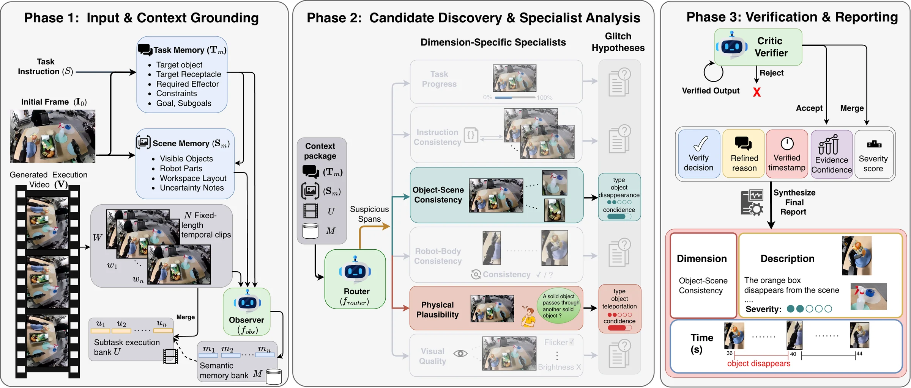
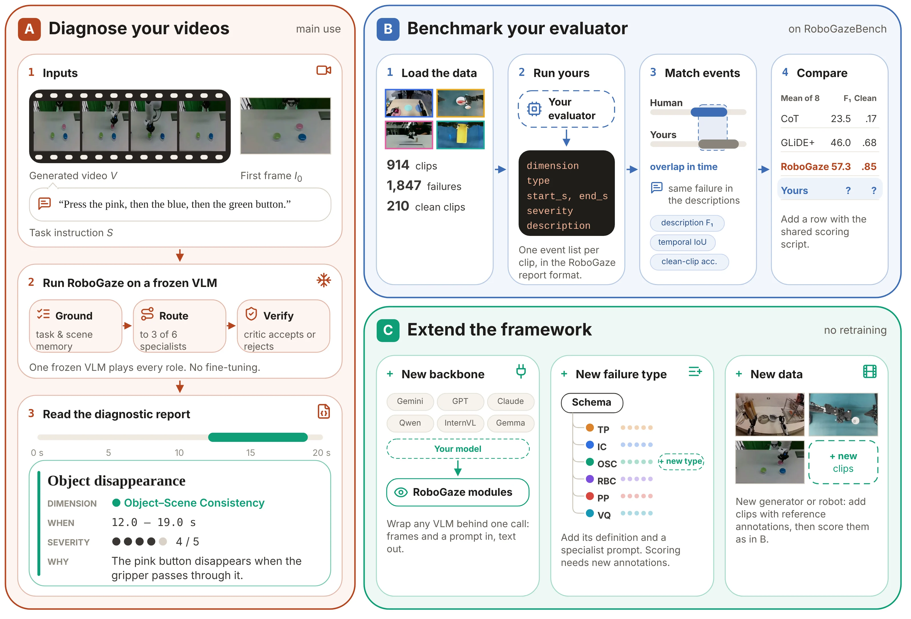

# RoboGaze: Evaluating Robot World Models via Structured Vision-Language Analysis

<p align="center">
  
</p>

<p align="center">
  <a href="https://robogaze-eval.github.io/"></a>
  <a href="https://arxiv.org/abs/2606.28385"></a>
  
</p>

RoboGaze is a training-free, multi-agent VLM framework for diagnosing failures in generated robot-manipulation videos. Given a task instruction, an initial frame, and a generated execution video, RoboGaze produces a structured report that explains what failed, when it failed, why it failed, and how severe the failure is.

This repository contains the official RoboGaze code release, including the local inference pipeline, OpenAI-compatible VLM client, batch runners, evaluation utilities, and static project page assets.

## Highlights

- **Explain each failure:** what failed, when, why, and how severely, rather than one score per video.
- **Training-free:** task-scene grounding, dimension-specific specialists, and critic verification on a frozen VLM.
- **RoboGazeBench:** 914 human-annotated generated manipulation clips, 1,847 time-stamped failures, six dimensions and 30 failure types.
- **Eight VLM backbones:** +11.3 description F1 points over the strongest baseline on average; correct empty reports on clean clips rise from 17% with CoT to 85% with RoboGaze.

Watch the [interactive diagnosis demos](https://robogaze-eval.github.io/#demo) or the [overview video](https://robogaze-eval.github.io/#overview).

## Overview

Robot world models can generate visually plausible manipulation rollouts that still violate task logic, physical plausibility, robot-body consistency, or object-scene consistency. Scalar metrics and monolithic VLM judges often miss these errors or over-report failures in clean clips.

RoboGaze addresses this with a three-stage diagnostic pipeline:

1. **Task-scene grounding**: parses the instruction and initial frame into task memory, scene memory, expected subgoals, visible objects, robot parts, and layout information.
2. **Specialist routing**: identifies suspicious temporal spans and dispatches them to dimension-specific agents over a robotics failure taxonomy.
3. **Critic verification**: re-examines candidate glitches, rejects weak hypotheses, merges duplicates, refines temporal boundaries, and emits a final structured report.

<p align="center">
  
</p>

The released implementation is intentionally transparent: intermediate JSON files and generated view clips are written to disk so that failed or ambiguous runs can be inspected.

## Results

Selected results from the [project page](https://robogaze-eval.github.io/#results). F1 values are reported on a 0–100 scale; clean-clip accuracy measures correct empty reports on failure-free videos.

| Evaluation | Comparison | RoboGaze |
|---|---:|---:|
| Description F1, mean over 8 backbones | Strongest baseline | **+11.3 points** |
| Clean-clip accuracy, mean over 8 backbones | CoT: 17%; GLiDE+: 68% | **85%** |
| Event F1, re-scored by blind human raters on the gold subset | GLiDE+: 61.4 | **71.6** |
| Usable-clip precision when selecting the top half of six candidates per condition | GLiDE+: 71%; random: 49% | **80%** |
| Description F1 gain on clips longer than 80 seconds | GLiDE+ | **+16.6 points** |

On Gemini 3.1 Pro, RoboGaze closes **83% of the gap** between chain-of-thought prompting and human agreement. See the [paper](https://arxiv.org/abs/2606.28385) for the full protocol and per-backbone comparisons.

## RoboGazeBench

The benchmark contains **914 clips from five generators**, spanning **4.9–148.9 seconds**, with **1,847 time-stamped failures** and **210 failure-free clips**. It covers simulated and real-world conditioning data and six diagnostic dimensions with 30 failure types.

Browse [benchmark coverage and the taxonomy](https://robogaze-eval.github.io/#benchmark). **Benchmark download: coming soon.** The inference code is available in this repository.

## Using and extending RoboGaze

[](https://robogaze-eval.github.io/#use)

| Goal | Start here |
|---|---|
| Diagnose your generated robot videos | [Single-video inference](#run-single-video-inference) or [batch inference](#run-batch-inference) |
| Compare event reports against human references | [Evaluate predictions](#evaluate-predictions); benchmark download pending |
| Use another VLM backbone | Configure the OpenAI-compatible endpoint and model in [single-video inference](#run-single-video-inference) |

RoboGaze diagnoses **visible failures in a single camera view**. An empty report does not establish that a generated behavior can be executed on a real robot. The pipeline uses several VLM calls per clip.

## Table of Contents

- [Overview](#overview)
- [Results](#results)
- [RoboGazeBench](#robogazebench)
- [Using and extending RoboGaze](#using-and-extending-robogaze)
- [Installation](#installation)
- [Serve a Local VLM](#serve-a-local-vlm)
- [Run Single-Video Inference](#run-single-video-inference)
- [Run Batch Inference](#run-batch-inference)
- [Evaluate Predictions](#evaluate-predictions)
- [Citation](#citation)
- [Acknowledgements](#acknowledgements)

## Installation

### 1. Clone and enter the repository

```bash
git clone https://github.com/cair-vinuni/RoboGaze.git
cd RoboGaze
```

### 2. Install core dependencies

RoboGaze uses `uv` for reproducible Python environment management.

```bash
uv sync
```

To serve the local VLM from the same environment, install the optional serving dependencies:

```bash
uv sync --extra serve
```

### 3. Install system media tools

RoboGaze expects `ffmpeg` and `ffprobe` on the system path. They are used to extract video windows, frame strips, refined clips, and media metadata.

```bash
ffmpeg -version
ffprobe -version
```

## Serve a Local VLM

The pipeline talks to an OpenAI-compatible chat-completions endpoint. The provided script starts a local vLLM server and exposes the model as `gemma4` at `http://localhost:8000/v1`.

```bash
bash scripts/serve_vlm.sh
```


## Run Single-Video Inference

Set the endpoint and model name, then run `robogaze` on one video:

```bash
export LOCAL_BASE_URL=http://localhost:8000/v1
export LOCAL_MODEL=gemma4

uv run robogaze \
  --task-instruction "Use the right hand to pick up the red cup and place it on the plate." \
  --initial-frame /path/to/initial_frame.jpg \
  --video /path/to/execution.mp4 \
  --output-dir outputs/robogaze \
  --video-id example_001 \
  --vlm-concurrency 8
```

You can also use the example wrapper:

```bash
bash scripts/run_example.sh
```

## Run Batch Inference

For prepared benchmark folders, use:

```bash
bash scripts/run_all_datasets.sh
```


Useful batch options:

```bash
uv run python scripts/run_robogaze_datasets.py \
  --input-root inputs/robogaze_dataset \
  --datasets gr1_real gr1_sim droid_mv \
  --output-dir outputs/robogaze_dataset \
  --cache-dir cache/robogaze_dataset \
  --vlm-concurrency 8 \
  --limit 10
```

The batch runner writes a JSONL summary and continues after per-sample failures unless `--fail-fast` is passed.


## Evaluate Predictions

The evaluation script compares RoboGaze reports against canonical ground-truth JSON files. It computes per-clip metrics, per-dimension metrics, temporal IoU, text-similarity matching, coverage, and clean-clip detection summaries.

```bash
export GEMINI_API_KEY=<your_key>

uv run python scripts/evaluate.py \
  --pred-dir outputs/robogaze_dataset \
  --gt-dir ground_truth \
  --out-dir report/robogaze_eval \
  --model gemini-3.1-flash-lite
```


## Citation

If you find RoboGaze useful for your research, please cite:

```bibtex
@misc{nguyen2026robogaze,
  title = {RoboGaze: Evaluating Robot World Models via Structured Vision-Language Analysis},
  author = {Nguyen, Minh-Loi and Diep, Nghiem T. and Nguyen, Hung K. and Le, Minh and
            Thien, Doanh L. and Tran, Tuan A. and Tran, Hoang H. and Le, Dung D. and
            Duong, Vu N. and Doan, Khoa D. and Le, Ngan and Sonntag, Daniel and
            Le, An T. and Ngo, Vien Anh and Nguyen, Duy M. H. and Nhiem, Tran V.},
  year = {2026},
  eprint = {2606.28385},
  archivePrefix = {arXiv},
  primaryClass = {cs.RO},
  doi = {10.48550/arXiv.2606.28385},
  url = {https://arxiv.org/abs/2606.28385}
}
```

## Acknowledgements

We thank the researchers and maintainers who release the models, datasets, and open-source tools that make this work possible, and the annotators who contributed the time-stamped failure annotations for RoboGazeBench.

The released implementation uses the following tools:

| Role | Projects |
|---|---|
| OpenAI-compatible VLM client | [OpenAI Python SDK](https://github.com/openai/openai-python) |
| Optional local VLM serving | [vLLM](https://github.com/vllm-project/vllm) |
| Video and image processing | [FFmpeg](https://ffmpeg.org/), [OpenCV](https://opencv.org/), [Pillow](https://python-pillow.org/) |
| Structured data and numerical utilities | [Pydantic](https://docs.pydantic.dev/), [SciPy](https://scipy.org/) |
| Environment management | [uv](https://github.com/astral-sh/uv) |

For the research benchmark, we acknowledge the teams behind **Cosmos-Predict2.5, DreamGen, DreamDojo, Wan 2.2, and Veo**, whose generators were used to produce the videos studied in the paper, as well as the creators of the source robot datasets and the VLM backbones evaluated in our experiments. Full experimental details and references are provided in the [paper](https://arxiv.org/abs/2606.28385).

Third-party software, model weights, and source datasets remain subject to their respective licenses and terms.
